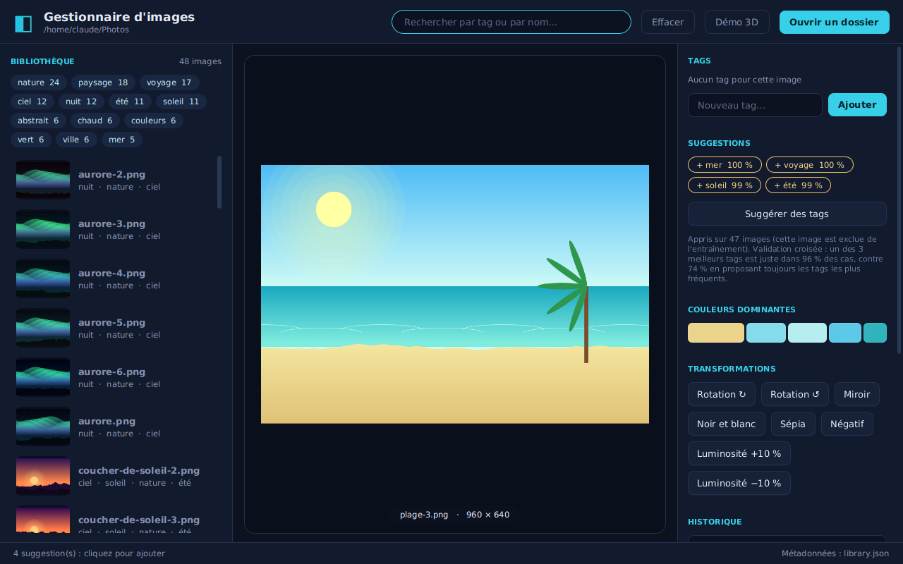

# Gestionnaire d'images — JavaFX

Application de bureau pour **organiser une photothèque** : on ouvre un dossier d'images, on leur
associe des **tags**, on leur applique des **transformations** (rotation, miroir, noir et blanc,
sépia, négatif, luminosité) et on les retrouve par **recherche**. Tags et historique de
transformations sont **sauvegardés** dans un fichier de métadonnées à côté des images : les
fichiers d'origine ne sont jamais modifiés.



## Télécharger l'application

Les **Releases** GitHub contiennent une application autonome pour Windows, macOS et Linux (runtime Java inclus :
rien à installer). Décompresser, lancer `GestionnaireImages`. Au premier lancement, l'application s'ouvre sur
une **bibliothèque de démonstration** embarquée (copie temporaire) ; « Ouvrir un dossier » permet d'utiliser ses propres images.

> macOS et Windows peuvent afficher un avertissement « développeur non identifié » : l'application n'est pas signée.

## Lancer depuis les sources

Prérequis : **JDK 21** et **Maven**.

```bash
mvn javafx:run                         # ouvre ./samples (48 images d'exemple)
mvn javafx:run -Djavafx.args="--folder=/chemin/vers/mes/photos"
mvn verify                             # compile + 110 tests unitaires
```

## Fonctionnalités

| | |
|---|---|
| **Tags** | ajout / suppression par image, nuage de tags cliquable pour filtrer |
| **Recherche** | par tag *et* par nom ; plusieurs mots = tous doivent correspondre ; insensible aux accents et à la casse (« ete » trouve « été ») |
| **Transformations** | rotation ±90°, miroir, noir et blanc, sépia, négatif, luminosité ±10 % |
| **Historique** | chaque transformation est enregistrée dans l'ordre ; on peut annuler la dernière ou tout effacer ; à la réouverture, l'historique est **rejoué** sur l'image d'origine |
| **Machine learning** | **suggestion de tags** : un modèle (régression logistique codée à la main) apprend des images déjà taguées et propose des tags pour une autre ; **couleurs dominantes** par k-means. Voir la section dédiée |
| **Chiffrement** | chiffre une image (transformations incluses) avec un mot de passe : **AES-256-GCM**, clé dérivée par **PBKDF2** (120 000 itérations), sel et IV aléatoires. Le résultat est un PNG de bruit ; un mauvais mot de passe ou une image retouchée est détecté au déchiffrement |
| **Démo 3D** | fenêtre qui trace une surface z = f(x, y) en 3D (4 fonctions, résolution réglable, rotation à la souris, zoom, mode filaire, légende des couleurs) avec les classes 3D natives de JavaFX ; sans 3D matérielle (machine virtuelle, WSL, pilote absent), repli automatique sur un rendu logiciel en perspective |
| **Export** | l'image transformée peut être enregistrée en PNG |
| **Persistance** | `library.json` (par défaut) ou `library.txt`, via une interface DAO |

## Architecture

```
fr.ndiaye.imagelib
├── model        Raster, ImageEntry, TransformationSpec, Tags        ← données immuables (records)
├── transform    ImageTransformation (interface scellée) + 6 implémentations,
│                TransformationFactory, TransformationPipeline       ← logique pure, sans JavaFX
├── ml           ImageFeatures, TagModel, ModelEvaluation, DominantColors  ← apprentissage automatique, sans bibliothèque
├── crypto       ImageCipher (AES-GCM + PBKDF2)                      ← chiffrement, sans JavaFX
├── surface      SurfaceFunction, SurfaceMesh                        ← maillage 3D calculé sans JavaFX
├── storage      MetadataDao (interface) → JsonMetadataDao, TextMetadataDao   ← DAO
├── service      ImageLibrary, TagAdvisor, DemoLibrary                                        ← cas d'usage : tags, recherche, historique
├── fx           FxImages (conversion JavaFX ⇄ Raster), SurfaceWindow (vue 3D)
├── controller   MainController                                      ← C de MVC
└── App          main.fxml (V) + style.css
```

Choix de conception :

- **MVC strict** : la vue est en FXML/CSS, le contrôleur ne contient aucune règle métier, tout passe par `ImageLibrary`.
- **Cœur testable sans interface graphique** : les transformations travaillent sur un `Raster` (tableau d'ARGB) et non sur un `Image` JavaFX ; les 110 tests tournent donc sur n'importe quelle machine, même sans écran (CI incluse).
- **Pattern DAO** : `MetadataDao` a deux implémentations interchangeables (JSON via Jackson, texte brut) validées par les **mêmes tests de contrat** (`MetadataDaoContractTest`).
- **Java 21** : `record` pour les données immuables, `sealed interface` pour l'ensemble fermé des transformations, `switch` avec filtrage de motifs.
- **Interface réactive** : le rendu et l'export tournent dans un `Task` hors du thread JavaFX ; un jeton ignore les rendus devenus obsolètes si l'on change d'image rapidement.
- **Chiffrement authentifié** : GCM détecte toute modification ; l'alpha n'est jamais utilisé pour stocker des octets (JavaFX stocke l'alpha prémultiplié, ce qui détruirait les couleurs) ; PBKDF2 tourne dans un `Task` pour ne pas figer l'interface.
- **Robustesse** : écriture atomique (fichier temporaire puis déplacement) ; si une sauvegarde échoue, la modification en mémoire est annulée ; un fichier de métadonnées corrompu est copié en `.corrupt` au lieu d'être écrasé ; les métadonnées d'images absentes du dossier sont conservées.

## Machine learning (codé à la main, sans bibliothèque)

Deux fonctionnalités, entièrement dans `fr.ndiaye.imagelib.ml`, testées sans interface graphique.

**Suggestion de tags (apprentissage supervisé).** Le bouton « Suggérer des tags » entraîne un modèle sur *vos* images déjà taguées, puis propose des tags pour l'image affichée.

1. **Caractéristiques** (`ImageFeatures`) : chaque image devient un vecteur de 70 nombres : histogramme de couleurs 4×4×4, luminosité, contraste, saturation, densité de contours, luminosité du tiers haut et du tiers bas.
2. **Modèle** (`TagModel`) : une régression logistique par tag (classification multi-étiquettes « un contre tous »), `p(tag | image) = σ(b + w·x)`, apprise par descente de gradient sur l'entropie croisée, avec régularisation L2, standardisation des caractéristiques et pondération des classes pour que les tags rares ne soient pas écrasés.
3. **Évaluation honnête** (`ModelEvaluation`) : validation croisée *leave-one-out* : chaque image est prédite par un modèle qui ne l'a jamais vue. Le score « hit@3 » (un des 3 meilleurs tags est juste) est comparé à une base de référence naïve (proposer toujours les 3 tags les plus fréquents). L'image analysée est aussi exclue de l'entraînement.

Mesure sur les 48 images d'exemple : **96 % contre 75 %** pour la base de référence (0,7 s).

**Limites, à connaître et à dire :**
- Le modèle voit des **couleurs et une disposition**, pas des objets. Sur l'image `ville-nuit-4`, il propose « nuit » mais aussi « ciel » et « nature », et rate « ville » (une ville de nuit ressemble à une aurore).
- Les images d'exemple sont **générées par code** : les catégories sont très différentes visuellement, ce qui rend la tâche plus facile que sur de vraies photos. Les 96 % ne se transposeront pas tels quels.
- Il faut au moins 6 autres images taguées, et un tag n'est appris que s'il apparaît sur au moins 2 images.
- Pour reconnaître des objets, il faudrait un réseau de neurones pré-entraîné (par exemple ONNX Runtime) : le modèle actuel est volontairement simple et lisible.

**Couleurs dominantes (apprentissage non supervisé).** `DominantColors` regroupe les pixels de l'image affichée en 5 paquets par **k-means** (initialisation k-means++, graine fixe donc résultat reproductible) ; chaque paquet donne une couleur et sa part de l'image.

## Affichage 3D : choix de `MeshView`

JavaFX n'a pas de graphique 3D prêt à l'emploi, mais ses classes 3D natives suffisent pour tracer une surface :
un `TriangleMesh` (sommets, coordonnées de texture, triangles), un `MeshView` dans une `SubScene` avec une
`PerspectiveCamera`, et les couleurs obtenues avec une palette utilisée comme texture (la hauteur normalisée
sert de coordonnée de texture).

- **Pour** : aucune dépendance, comportement maîtrisé, intégration directe à l'interface JavaFX existante.
- **Repli** : si `ConditionalFeature.SCENE3D` n'est pas disponible (message « System can't support ConditionalFeature.SCENE3D »), `SoftwareSurfaceRenderer` projette le même maillage sur un `Canvas` 2D (perspective + tri des triangles du plus lointain au plus proche) : mêmes commandes, un peu moins fluide.
- **Contre** : il faut écrire soi-même le maillage, les axes, la légende et la sélection de points.
- **À comparer** si le besoin grandit : des bibliothèques construites sur JavaFX 3D (FXyz3D, Jzy3d…) qui fournissent
  axes et graduations ; non évaluées ici.

Le calcul du maillage (`SurfaceMesh`) est séparé de la vue : il est testé unitairement (nombre de sommets et de
triangles, échelle des hauteurs, singularité de `sin(r)/r` en 0, indices valides) et change de bibliothèque d'affichage sans rien réécrire.

## Ajouter une transformation

1. Créer un `record` qui implémente `ImageTransformation` (et l'ajouter à la clause `permits`).
2. L'enregistrer dans `TransformationFactory` (création depuis la sauvegarde + libellé français).
3. Ajouter un bouton dans `main.fxml` et un gestionnaire dans `MainController`.

Le compilateur signale tout `switch` incomplet grâce à l'interface scellée.

## Pistes d'amélioration

- Annuler / rétablir (pile redo), réglage continu de la luminosité avec un curseur
- Filtres convolutifs (flou, netteté) ; chargement des vignettes dans un cache disque
- Affichage 3D (courbes / surfaces) via `SubScene` / `MeshView` — cf. les technologies à comparer pour JavaFX

## Publier une version

```bash
git tag v1.0.0 && git push origin v1.0.0
```

Le workflow `release.yml` compile, teste, crée l'application avec `jpackage` sur les trois systèmes et attache les archives à la Release.
